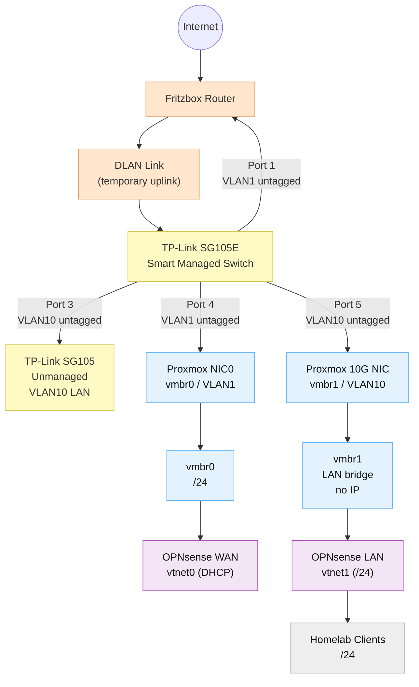

# 04 — Network Architecture

## 4.1 High-Level Design Diagram

<!-- pagebreak -->

---

> **Addressing redacted.** Exact IPs, the VLAN port map and the master PDF live in a private repository. This published version keeps the design reasoning and the configuration approach; any address shown as `<lab-subnet>`, `<home-lan>` or `<lab-gateway>` is a placeholder.

## 4.2 What actually runs

The diagram above is the design. This is what is plugged in and answering today.

| Host | Role | Segment | Notes |
|---|---|---|---|
| OPNsense | firewall + router + DHCP + NTP | `<lab-gateway>` | only 80 (redirect) and 443 (WebGUI) exposed |
| Proxmox node | hypervisor | VLAN1 management | hosts the VMs below |
| Services VM | the websites, Postgres, the tooling | `<lab-subnet>` | nginx, containers, loopback-only database |
| **NAS** | file storage and backup target | home LAN | 2×4TB WD Red in RAIDZ1, SMB + NFS shares |
| **Pentest box** | deliberately vulnerable practice target | `<lab-subnet>` (isolated) | Metasploitable 2 — see below |

## 4.3 Why the vulnerable box lives there

Metasploitable 2 is a machine that is *supposed* to be broken: telnet, rsh, an
unauthenticated VNC, Samba 3, an Apache from 2008. Keeping it useful means keeping it
away from everything that matters, without making it awkward to use.

Three rules do the work:

1. **It sits on the lab subnet, not the home LAN.** Its only route out is through the
   firewall, and the firewall only allows what a scan needs.
2. **Nothing on the LAN may initiate a connection to it.** Any traffic from the lab
   towards the home network is denied by default, so a box that gets owned stays owned
   in one place.
3. **It is never a target from the internet.** No port forwarding, ever — the whole
   point is to practise on it while it is unreachable to anyone else.

The NAS is the opposite case: it holds the backups, so it lives on the home LAN, is
reachable from the lab only through an explicit rule, and is never exposed. The
segmentation is what lets a broken machine and the backup of everything else exist on
the same switch.

Inside the lab subnet everything still uses version detection, TLS and a real scan
policy. A target that answers "everything is open" teaches nothing about triage — see
[[Vantage]] for how the findings are graded.
